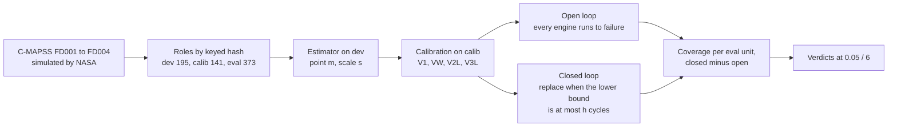

# closed-loop v0.2: does conformal remaining-life coverage survive a replacement policy?

[](LICENSE)
[](data/MANIFEST.json)

> A pre-registered test of whether conformal remaining-life intervals keep their coverage once a replacement policy acts on them, on NASA's C-MAPSS turbofan trajectories. The estimator, the tuned values and the decision rules were fixed before the held-out units were read, and a loss is published at the same size as a win.

**C-MAPSS is simulated by NASA's C-MAPSS engine model. It is not field data.** Every result here is about C-MAPSS degradation, not about a real engine fleet.

## Why this exists

Scored open loop, a remaining-life interval is checked at every cycle of engines that all run to failure. In use, a policy acts on it. It replaces an engine once the lower bound gets low, so the checkpoints that count are the ones the policy reaches, and a method that learns from outcomes sees only the outcomes the policy lets happen. A replaced engine does not show when it would have failed.

[closed-loop v0.1](https://github.com/darrshangovender/closed-loop) asked this on a synthetic plant it simulated itself. Its pooled result was a loss for the thesis that open-loop calibration does not carry over to the closed loop, and its result in the trend-estimated stratum was inconclusive. v0.2 asks the same question of trajectories this repository did not generate: NASA's C-MAPSS data, subsets FD001 to FD004.

## Results

There was one full run, on 10 November 2026, after the freeze. Every number below is in the generated block that follows, in [benchmarks/RESULTS.md](benchmarks/RESULTS.md) or, at full precision, in [benchmarks/results.json](benchmarks/results.json). In plain terms:

- **V1, calibrated once, stayed inside the band when the loop closed.** Closed-loop minus open-loop lower-bound coverage, paired by unit, was -0.0058 pooled over the 373 evaluation units (interval -0.0255 to 0.0143) and 0.0002 in the decision stratum, 309 units (interval -0.0237 to 0.0240). Both intervals lie inside the band of 0.03 either side of zero, so both V1 rows of C2-PERC are a loss for the thesis.
- **V2L, which learns from the lives the policy ends, lost coverage.** Its gap was -0.0767 pooled (interval -0.0864 to -0.0670) and -0.1000 in the stratum (interval -0.1198 to -0.0802). Both intervals lie below -0.03, so both V2L rows are a win for the thesis. V2L counts a label whose outcome is unknown as a hit, and V3L skips it. After each life both raise `alpha_t` when that life's miss rate over the labels they count is below 0.1, and a higher `alpha_t` gives narrower intervals. In the closed loop V2L's final `alpha_t` ran from 0.3485 to 0.3895 over the 20 orders and V3L's from 0.3025 to 0.3359, against 0.0871 to 0.1370 open loop for both and a target of 0.1. V2L's mean finite width was 19.2 cycles against 28.8 open loop. V3L lost less: -0.0592 pooled at the descriptive level, a row with no label. The run does not test which part of the update causes the loss.
- **VW, weighted towards the checkpoints the policy reaches, did not beat V1.** Its closed-loop lower-bound coverage was 0.9449 against V1's 0.9596. The paired difference, VW minus V1, was -0.0147 (interval -0.0343 to 0.0056). Its upper end is below the registered margin of 0.02, so C2-SELECT is a loss. VW's fixed-point steps settled in the nominal condition, so the rule for a two-cycle did not come into play.
- **V1 on NASA's own test units was inconclusive, with the low end of its interval just below 0.92.** At their last observed cycle, 669 of the 707 test units had a capped truth at or above V1's lower bound: 0.9463. The Clopper-Pearson interval runs from 0.9199 to 0.9661. Its low end, 0.9198539044160058 at full precision, is below the lower edge of the registered range of 0.92 to 0.98, so C2-EXT is inconclusive, not a win.
- **Under a fault mode missing from the calibration data** (secondary, no label), V2L's closed-loop lower-bound coverage was below V1's by 0.0295 (interval -0.0566 to -0.0013, at 0.05) and V3L's by 0.0240 (interval -0.0511 to 0.0040). Neither estimate is above zero. These rows decide nothing.
- **What the policy did** (descriptive). In the nominal closed loop no V1 or VW unit failed unreplaced; for V2L the fraction was 0.0054 per order and for V3L 0.0043. The mean remaining life at replacement, uncapped, was 22.9 cycles for V1, 17.0 for VW, 11.8 for V2L and 12.7 for V3L. In the closed loop V2L's intervals were narrower than V1's (mean finite width 19.2 cycles against 31.2), it replaced engines with less life left, and its coverage was lower; the run records these together and does not test how they are linked.

Five of the six primary rows (the three on the betting interval and the two V2L rows) carry a nominal level, not a proven one: the betting interval is fed its values in a fixed order rather than a random one, and V2L's per-unit values are coupled through its shared `alpha_t`. Only C2-EXT, an exact binomial interval, is not affected. The section "Limitations" says more.

<!-- RESULTS:BEGIN -->

<!-- Generated by benchmarks/run.py from benchmarks/results.json; do not edit between the markers. -->

**C-MAPSS: simulated by NASA's C-MAPSS model, not field data.**

Truth: min(remaining life, 125 cycles). Bounds, scores, coverage, labels and C2-EXT are measured against it, and bounds are limited to 125. Remaining life at replacement (the cost) is uncapped.

| Claim | Row | Verdict | Estimate (interval) | Interval rule |
|---|---|---|---|---|
| C2-PERC | V1, pooled | loss | -0.0058 (-0.0255 to 0.0143) | betting |
| C2-PERC | V1, stratum | loss | 0.0002 (-0.0237 to 0.0240) | betting |
| C2-PERC | V2L, pooled | win | -0.0767 (-0.0864 to -0.0670) | t |
| C2-PERC | V2L, stratum | win | -0.1000 (-0.1198 to -0.0802) | t |
| C2-SELECT | VW minus V1, closed-loop c^lo | loss | -0.0147 (-0.0343 to 0.0056); VW's c^lo 0.9449 (0.9212 to 0.9620) | betting; VW's c^lo betting |
| C2-EXT | V1 lower-bound coverage, external units | inconclusive | 0.9463 (0.9199 to 0.9661) | clopper-pearson |

Level 0.00833 for each primary row. Rules, secondary rows and every table: `benchmarks/RESULTS.md`.

<!-- RESULTS:END -->

The block above is generated from `benchmarks/results.json` by `benchmarks/run.py`, and `python benchmarks/run.py --check` regenerates it and fails if a byte differs. The full report, with the secondary rows, the per-subset breakdown, the policy outcomes and VW's step history, is [benchmarks/RESULTS.md](benchmarks/RESULTS.md). The claims, rules and levels were fixed in [docs/PREREGISTRATION.md](docs/PREREGISTRATION.md), and section 12 of it lists what had been seen before the freeze.

## How it works



**Data and roles.** FD001 to FD004 hold 100, 260, 100 and 249 training engines that run to failure, and 707 test engines that stop before failure, with the true remaining life at their last cycle in NASA's `RUL_FD00x.txt`. A keyed hash of subset and unit number assigns each training engine to dev (195), calib (141) or eval (373), whatever its rows hold. Dev units were used to build and tune everything. Eval units and NASA's test files were held out until the freeze: `HeldoutAccess` refuses them before the ledger has a `freeze` entry and writes a ledger line before each read. The shifted condition fits and calibrates on FD001 and FD002 and evaluates on FD003 and FD004, whose second fault mode is absent from FD001 and FD002.

**Truth.** `min(remaining life, 125 cycles)`, a common choice in C-MAPSS work. The first tuning run used the uncapped remaining life; no dev unit failed unreplaced and the mean remaining life at replacement was 119.8923 cycles or more at every threshold tried, so the closed loop tested nothing ([ADR 0003](docs/adr/0003-tuning-protocol.md), section 7). The cap was fixed then, on dev units, before any calib, eval or test value was used. Both ends of an interval are limited to 125, and the remaining life at replacement, a cost, stays uncapped.

**Estimator.** Six operating conditions found by k-means on the dev settings, per-condition z-scores, the mean and slope of each kept sensor over a window of 50 cycles, and the cycle count. Two gradient-boosted models share these features: `m` on the capped truth, and `s` on `|truth - m|` from unit-grouped 5-fold cross-fitting, floored at 2 cycles. The interval is `[m + s q_lo, m + s q_hi]`, two-sided at 0.90, so the nominal lower-bound coverage is 0.95.

**Methods.** Each one sets the quantiles `q_lo` and `q_hi` from the scores `(truth - m) / s`:

| Method | What it does |
|---|---|
| V1 | split conformal on one checkpoint drawn uniformly from each calibration unit |
| VW | weighted conformal over the checkpoints the policy reaches on each calibration unit (Tibshirani, Barber, Candès and Ramdas 2019), by 10 fixed-point steps from V1's quantiles |
| V2L | adaptive conformal inference (Gibbs and Candès 2021), `gamma` 0.02, updated when a life ends; a censored label counts as a hit |
| V3L | as V2L, but a label whose outcome is unknown is skipped |

**Policy and replay.** Replace at the first checkpoint whose lower bound is at most `h` = 5 cycles. Twenty engines run at once, in 20 random orders, and open and closed loop use the same orders. In the open loop nothing is replaced, every life ends in failure, and the online methods see exact labels. In the closed loop a replaced engine contributes its checkpoints up to the replacement, and its labels come from the cycles it is known to have survived: a miss, a hit on the lower bound, or unknown. At a checkpoint it is known to have outlived by 125 cycles or more, the capped truth is known exactly and the label is a hit or a miss. A replacement does not change any other engine.

**Claims.** Three primary claims, six verdicts, judged at 0.05 / 6:

| Claim | Question | Primary |
|---|---|---|
| C2-PERC | Does open-loop lower-bound coverage carry over to the closed loop? Four verdicts: V1 and V2L, pooled and in the decision stratum (`m` at most 35 cycles) | yes |
| C2-SELECT | Does calibrating on what the policy lets through restore closed-loop coverage? VW against V1 | yes |
| C2-EXT | Does V1's calibration carry over to NASA's 707 test units at their last observed cycle? | yes |
| C2-CENSOR | Does online recalibration on policy-censored labels add to the gap? | secondary, no label |
| C2-SHIFT | Under the unseen fault mode, does online recalibration help? | secondary, no label |

**Statistics.** A mean of per-unit values uses a Student-t interval only when there are at least 100 units, the values are not all equal and the sample kurtosis is at most `n / 50`, v0.1's guard. Otherwise it uses the fixed-sample betting interval of Waudby-Smith and Ramdas (2024), [ADR 0004](docs/adr/0004-fixed-sample-betting-interval.md). C2-EXT uses an exact Clopper-Pearson interval. Secondary rows are shown at 0.05 and decide nothing.

## Reproducing

```bash
git clone https://github.com/darrshangovender/closed-loop-v2 && cd closed-loop-v2
python -m venv .venv && source .venv/bin/activate        # Windows: .venv\Scripts\activate
pip install -e ".[dev]"

python benchmarks/run.py --check      # needs no data: the ledger, the hashes, RESULTS.md, the README block and every verdict
python scripts/fetch_cmapss.py        # NASA's zip, 12,429,152 bytes, checked against data/MANIFEST.json
python benchmarks/run.py --quick      # the whole pipeline on dev units only; no ledger entry
```

`pip install -e ".[dev]"` fetches closed-loop v0.1 from GitHub at tag `v0.1.0`. If that tag cannot be reached, install from a local checkout of v0.1 instead, as in [Development](#development).

The repository does not redistribute C-MAPSS. `scripts/fetch_cmapss.py` downloads NASA's zip, checks its size and SHA-256 and every member's SHA-256 against `data/MANIFEST.json`, and writes the 14 files only if every check passes. Set `CLOSED_LOOP_V2_DATA` to keep them somewhere other than `data/cmapss`.

`--quick` re-splits the dev units into fit, calibration and evaluation, reads no held-out file and writes its report to `benchmarks/.cache/` under the banner "QUICK RUN, NOT A RESULT". On an old laptop with two cores and four threads, `--quick` took 60 s and the full run 158 s. In a clean install from a fresh copy of the repository on 11 November, with other work running on the same laptop, `--quick` took 131 s on Python 3.12 and 89 s on Python 3.11.

`python benchmarks/run.py --full` reads the held-out data and appends to the ledger. A second full run writes its own `results.json`, `RESULTS.md` and README block, keeps a copy as `benchmarks/runs/results-run-2.json` and lists run 1 in its report, with its time, digest, archived copy and a count of its verdicts by label; the ledger keeps each of run 1's verdicts. Run 1's copy, `benchmarks/runs/results-run-1.json`, is not replaced, and `--check` compares it with its ledger digest. [benchmarks/README.md](benchmarks/README.md) lists every mode and exit code.

## Development

v0.2 imports v0.1 as a library, by URL and tag. To use a local checkout of v0.1 instead, install it first and this package without its dependencies, then the remaining ones:

```bash
pip install -e ../closed-loop
pip install --no-deps -e .
pip install "scikit-learn>=1.4" "threadpoolctl>=3.1" "pytest>=8.0" "ruff>=0.6" "hypothesis>=6.100" "mypy>=1.10"
```

The freeze recorded Python 3.12.13, numpy 2.5.4, scipy 1.18.1 and scikit-learn 1.9.1 (the `freeze` line of `benchmarks/ledger.jsonl`). Python 3.11 is declared and is in the CI matrix, but it was not run for the recorded results. A clean install by the commands above on Python 3.11.15, on 11 November, resolved numpy 2.4.6 and scipy 1.17.1, passed all 628 tests, and wrote a `--quick` report byte for byte the same as the one on Python 3.12.

## Design decisions

**A new repository, with v0.1 left as it is.** v0.1's code hash covers its package, so adding v0.2 inside it would change the hash its published numbers carry. v0.2 depends on v0.1 for the hash-chained ledger, the pre-registration and code hashes, the heavy-run guard, the t-interval guard and Clopper-Pearson ([ADR 0001](docs/adr/0001-design.md), sections 2 and 12).

**Held out by unit number.** A unit's role comes from a keyed hash of its subset and number, so it cannot depend on what the unit's data look like. Calib and eval units are exchangeable draws from the same pool. Roles were not stratified by subset, and the subset mix differs by chance (FD002 is 41.8% of calib and 36.7% of eval).

**A fixed-sample interval instead of v0.1's confidence sequence.** The evaluation set is fixed in advance and analysed once. The reachability check found that v0.1's confidence sequence had a median half-width of 0.0600 at 373 units, so a C2-PERC loss, an interval inside a band of 0.03, could not be reached at all. The interval was replaced before the freeze, and that change left the claims, bands, levels and verdict rules as they were ([ADR 0004](docs/adr/0004-fixed-sample-betting-interval.md)).

**What each verdict could reach was checked before the freeze.** `scripts/reachability.py` ran the registered interval and verdict code on made-up values from dev units, resampled to the registered sizes, and recorded which labels each row could reach ([docs/REACHABILITY.md](docs/REACHABILITY.md)). After its first run the interval was replaced, as above; that step changed no claim, band, level or verdict rule. The rule for VW's end state was changed later, as the next paragraph says.

**VW's end state is part of the rule.** VW's fixed-point steps can stop moving, alternate between two pairs of quantiles, or do neither. C2-SELECT was first registered as inconclusive unless VW settled. VW settled in only one of three dev fits, so before the freeze the rule was changed to judge a two-cycle with both pairs and keep a label only if both give it. A settled VW gets the same label under both rules.

**What the ledger shows.** A published number came from a run whose pre-registration, `tuned.json`, code and data-manifest hashes match the freeze, each held-out read is recorded before it happens, and a later edit to a past entry breaks the chain. It does not show that the machine clock was right. C-MAPSS is public, so the held-out rule binds this code's path to the data, not a person with the files; the freeze is a recorded commitment, not a secret.

## Limitations

- **Simulated data.** The trajectories come from NASA's C-MAPSS engine model. A result here, positive or negative, is about C-MAPSS degradation.
- **No physics feedback.** Replacing one engine does not change another. In a plant where maintenance changes the load on the rest of the equipment, VW's covariate-shift argument would not hold as it stands.
- **One policy, one threshold.** The bound rule is tested at `h` = 5 cycles, tuned on dev. Other policies select other checkpoints.
- **Small strata.** FD003 contributes 16 calibration units. The shifted condition calibrates on 80 units and evaluates on 182.
- **A nominal level for five of the six primary rows**, the three on the betting interval and the two V2L rows. The betting interval's validity needs the values fed in a uniformly random order; here they are fed in a fixed canonical order, so the subset order of the units cannot change the result. V2L's per-unit values are coupled through the shared `alpha_t`, which every earlier unit in the queue has moved: on dev units the correlation between queue position and a unit's V2L gap was -0.4007. For the rows these touch, the level is nominal, not proven.
- **What the methods promise.** V1's statement covers a checkpoint drawn uniformly from a unit's life. It does not cover checkpoints a policy chose, nor NASA's truncation points, which is why C2-EXT is an empirical check. VW's statement is approximate, because its policy depends on the calibration data through the fixed-point steps. In the shifted condition VW's steps ended in a two-cycle; no primary row uses that condition.
- **Decisions made in light of dev numbers.** The cap, the limit on both bounds, the change of interval, the scoping of the level as nominal and the rule for VW's end state were all decided before the freeze, each after looking at dev results. Each is recorded in section 12 of the pre-registration. None changed a claim, band, margin, floor or level.
- **No outside review.** The adversarial reviews before the freeze were internal to the project. No one outside it has reviewed the design, the code or the results.

## Project layout

```
closed_loop_v2/
  data/         roles by keyed hash, the verified loader, the held-out gate (HeldoutAccess)
  features.py   features from rows up to each checkpoint only
  estimator.py  the shared point and scale models
  conformal.py  V1, VW, V2L and V3L
  policy.py     the bound rule
  replay.py     the fleet replay, open and closed loop
  metrics.py    coverage, Gap_B and policy outcomes
  stats.py      the fixed-sample betting interval
  verdicts.py   the decision rules and their constants
  report.py     results.json to RESULTS.md and the README block
  seeds.py      run seeds derived from the pre-registration hash
  audit.py      the audit trail, on v0.1's ledger and hashes
benchmarks/     run.py, results, ledger, tuned values, archived runs
data/           MANIFEST.json: the SHA-256 of each C-MAPSS file
docs/           pre-registration, decision records, tuning and reachability records
scripts/        data download, tuning, the dev-point and reachability checks
tests/          the suite
```

## Tests

```bash
pytest tests/ -q
ruff check . && ruff format --check .
mypy
```

Tests marked `data` need the C-MAPSS files and are skipped without them. With the files present, the whole suite, slow tests included, gave 628 passed in 291.75 s on that laptop before the freeze. In the clean install of 11 November, with other work running, all 628 passed again; the command took 638 s on Python 3.12 and 476 s on Python 3.11. The held-out gate, the roles, the betting interval, the verdict rules and the report have their own tests.

## Data acknowledgement

The NASA data repository asks users to acknowledge it and the donors of the data. The C-MAPSS data are:

- A. Saxena and K. Goebel (2008). "Turbofan Engine Degradation Simulation Data Set", NASA Prognostics Data Repository, NASA Ames Research Center, Moffett Field, CA.
- A. Saxena, K. Goebel, D. Simon and N. Eklund (2008). "Damage Propagation Modeling for Aircraft Engine Run-to-Failure Simulation", Proceedings of the 1st International Conference on Prognostics and Health Management (PHM08), Denver, CO.

---

Built by [Darrshan Govender](https://github.com/darrshangovender) · [Agulhas Code](https://agulhascode.co.za)
